# One job, three tools: following up on stalled deals

**Time:** about 10–12 minutes, after setup. **You'll use:** the HubSpot connector in Claude (MCP), Agent CLI, the CRM APIs, and Claude Cowork scheduled tasks. **You'll end up with:** a saved prompt, a reusable CLI script, a small API script, and a scheduled task that runs every weekday, plus a clear sense of which to reach for next time.

Line up follow-ups on deals that have gone quiet, so they're waiting for your reps every morning. You'll have your agent do the job two ways, look at the API calls underneath, then put it on a schedule: find open deals with no activity in the last 14 days, and create a follow-up task on each for the deal owner. Same job, same account, same result. What changes is how much you write, how much you control, and how often it can run without you.

## Pick your path. Choose one before you start:

| | Prompts only (no code) | Full version |
| --- | --- | --- |
| Steps | 1, 2, 5, then Clean up | 1 through 5, then Clean up |
| Time | About 6 minutes | About 10 to 12 minutes |
| You'll need | A developer test account and the Claude desktop app with the HubSpot connector and Cowork | Everything in Prompts only, plus Claude Code or Codex, Agent CLI, Node.js 18+, jq, a service key and the starter repo |
| You'll end up with | A saved prompt and a scheduled task | Those two, plus a reusable CLI script and an API script |

## Before you start (setup, not timed)

**Everyone needs:**

- A [free HubSpot developer test account](https://developers.hubspot.com/docs/getting-started/account-types#create-a-developer-test-account). Don't use a production account: this exercise creates and deletes records. During setup, you'll grant access to deals, tasks and owners. These are the exact [scopes](https://developers.hubspot.com/docs/apps/developer-platform/build-apps/authentication/scopes) needed for this exercise: `crm.objects.deals.read`, `crm.objects.deals.write`, `crm.objects.contacts.read`, `crm.objects.contacts.write` and `crm.objects.owners.read`.
- [Claude with the HubSpot connector installed](https://knowledge.hubspot.com/integrations/set-up-and-use-the-hubspot-connector-for-claude) to your Claude instance and connected to that test account. Step 5 also uses Claude Cowork scheduled tasks, so you'll need a Claude plan that includes Cowork and the Claude desktop app, since Cowork isn't available in Claude on the web.

  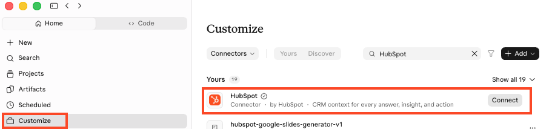

  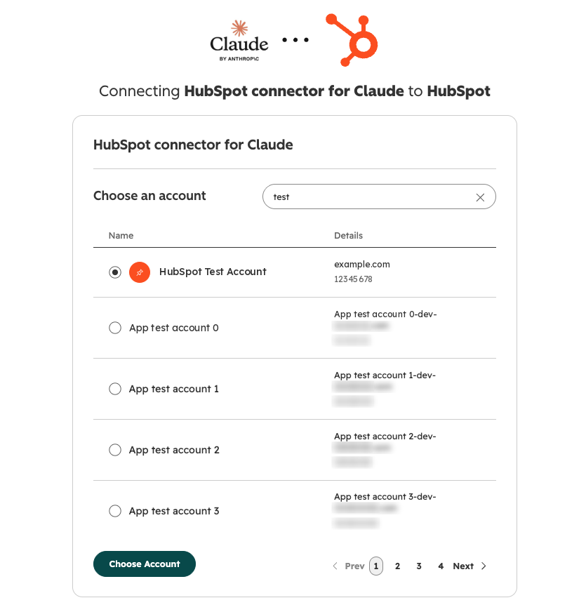

**Full version only:**

- Clone the [starter repo from GitHub](https://github.com/hubspotdev/builder-exercises/tree/main), and open in your terminal:

  ```sh
  git clone https://github.com/hubspotdev/builder-exercises.git && cd builder-exercises/exercises/ex01-one-job-three-tools
  ```

- [Claude Code (or Codex) with Agent CLI installed](https://developers.hubspot.com/docs/build-with-ai/agent-cli) and authenticated to your test account. Choose one installation option:

  **Option A: Let your agent install it (no terminal commands)**

  Paste this prompt into Claude Code or Codex on your computer and follow along. Don't use claude.ai on the web, where Claude installs the CLI in a temporary sandbox that can't finish logging in to your account. The prompt installs the CLI, logs you in and adds the Agent CLI Skills.

  ```text
  Install the HubSpot Agent CLI in this agent workspace. If this workspace uses a POSIX shell (macOS, Linux, WSL, or Bash), run `curl -fsSL https://api.hubapi.com/hub/cli/backend/hub-cli/latest/install.sh | sh`. If it uses Windows PowerShell, run `irm https://api.hubapi.com/hub/cli/backend/hub-cli/latest/install.ps1 | iex`. Then authenticate with `hubspot auth login`, install HubSpot Agent CLI Skills with `npx skills add hubspot/agent-cli-skills`, and use `hubspot --help` to explore what's available.
  ```

  The agent will prompt you to log in to your dev test account; choose your developer test account. After selecting your account and completing authentication, you'll be given a code to copy/paste into your agent workspace to finish installation.

  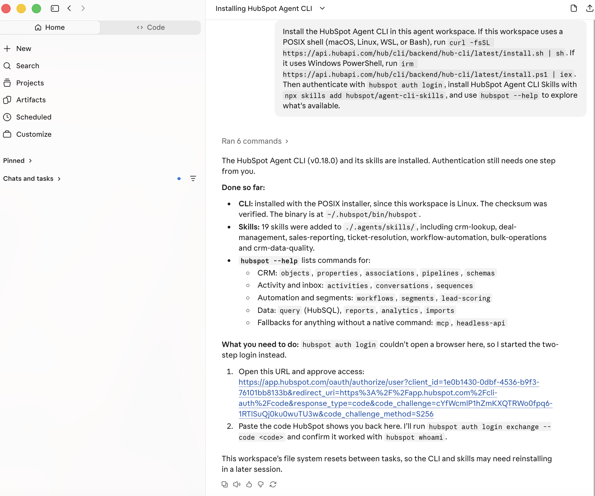

  **Option B: Install it yourself in the terminal**

  Run the install command:

  ```sh
  curl -fsSL https://api.hubapi.com/hub/cli/backend/hub-cli/latest/install.sh | sh
  ```

  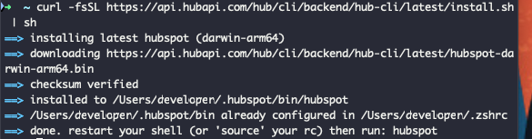

  Open a new terminal and run the following commands:

  ```sh
  unset HUBSPOT_ACCESS_TOKEN
  hubspot --version
  hubspot auth login
  hubspot whoami
  ```

  > **Note:** When executing `hubspot auth login`, a modal will pop up asking you to select access to your HubSpot account. Make sure you select View and Create, delete, or make changes to for deals and tasks, plus View details about users assigned to a CRM record (owners). You can leave everything else unselected.

  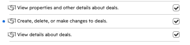
  
  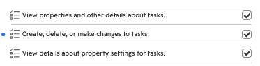

  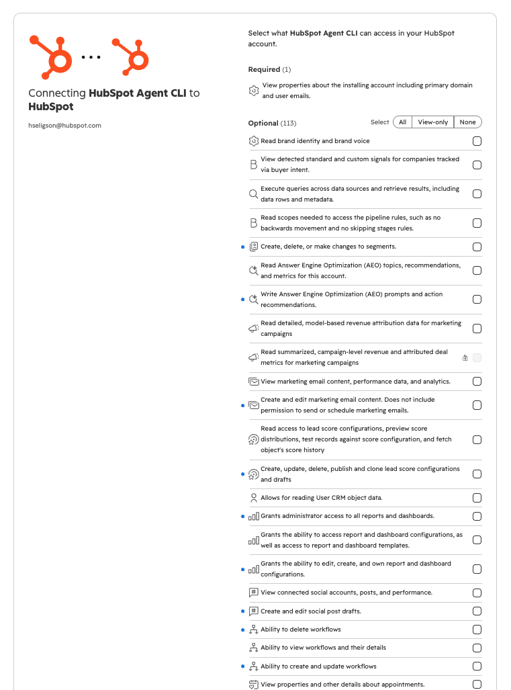

  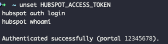

  > **Note:** To log out of a specific HubSpot account: `hubspot auth logout`

  In the same terminal, run the following command and select all skills:

  ```sh
  npx skills add hubspot/agent-cli-skills
  ```

  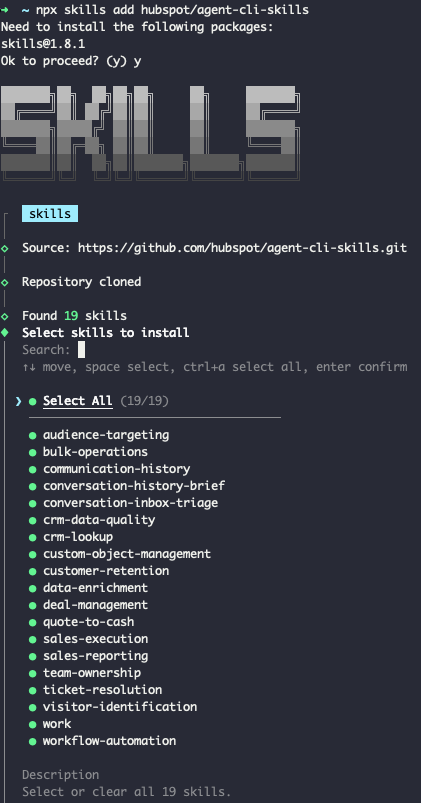

  After you select your skills, choose your applicable Agent.

  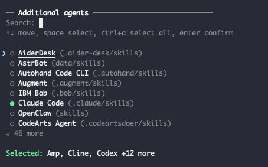

  Finally, choose your Installation scope: if leveraging the GitHub repo, choose Project; otherwise choose Global, and Symlink for the installation method. When it finishes, ask your agent to run `hubspot whoami` and confirm it shows your test account.

  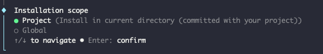

- After either option, you also need:
  - `jq`, which the Agent CLI Skills use to process command output. On macOS, run `brew install jq`.
  - Node.js 18 or later, and a [service key](https://developers.hubspot.com/docs/apps/developer-platform/build-apps/authentication/account-service-keys#create-a-service-key) for the test account with exactly these scopes: `crm.objects.deals.read`, `crm.objects.deals.write`, `crm.objects.contacts.read`, `crm.objects.contacts.write` and `crm.objects.owners.read`.
    - To create one, go to Development, then Keys > Service keys, and click Create service key. [Save it as an environment variable](https://developers.hubspot.com/docs/developer-tooling/local-development/agent-cli/guide#admin-mode-via-service-key-token) via your terminal:

      ```sh
      export HUBSPOT_TOKEN={add-your-service-key-value-here}
      ```

      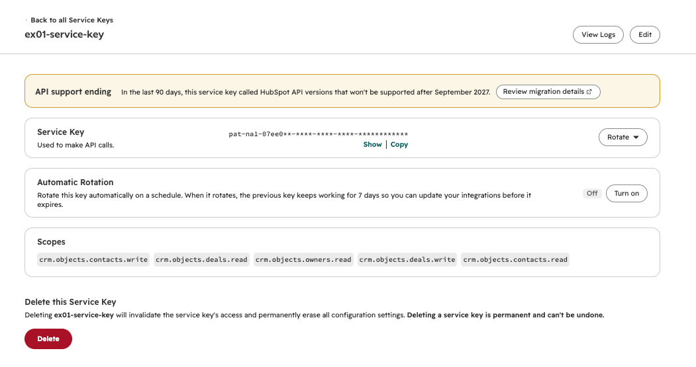

    > **Note:** This key does two jobs: the API script in step 4 reads it, and step 3 uses it as a fallback for the few Agent CLI commands that need account-level access. Don't export it as `HUBSPOT_ACCESS_TOKEN` for the whole session. If you do, every Agent CLI command runs in admin mode instead of with your own login.

The starter repo contains the following files: `seed.mjs`, `stalled-deals.mjs` (the API script) and `cleanup.mjs`. Step 3 creates `cli/ex01-stalled-deals.sh` (the Agent CLI script). Every record in this exercise will start with `EX01`, so it's easy to find and remove.

## Steps

### 1. Create the sample deals (1 minute)

**Prompts-only path.** Paste this prompt into your agent of choice (we'll use Claude) once you've connected your HubSpot account:

```text
Use the HubSpot connector, not the Agent CLI. Create three open deals in my default pipeline named "EX01 Acme renewal", "EX01 Initech expansion" and "EX01 Globex pilot", each owned by me. Don't log any activity on them. Before you create anything, list the three deals with the pipeline, stage and owner you plan to use, and wait for my OK.
```

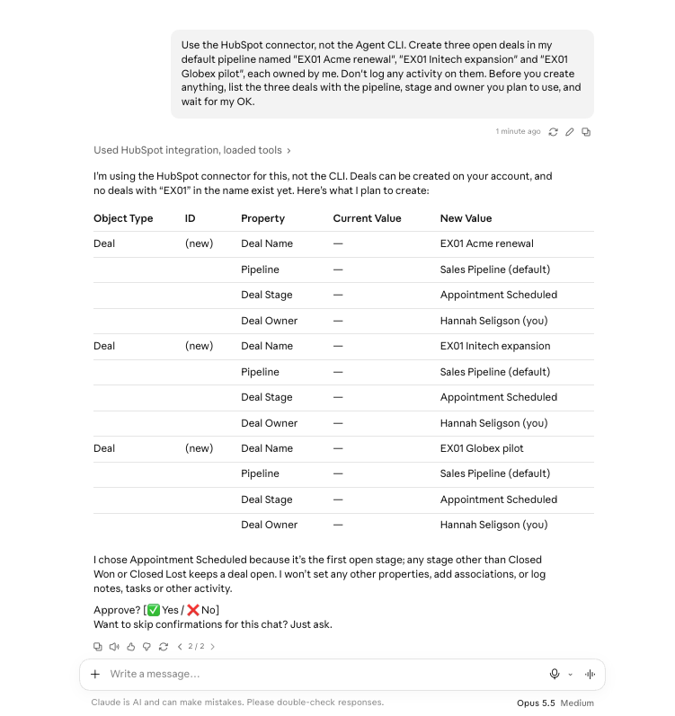

**Full-version path:** In the starter repo within the folder `ex01-one-job-three-tools`, run the following command:

```sh
node seed.mjs
```

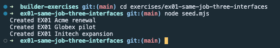

**You should see:** three "Created EX01" lines, and three EX01 deals in your pipeline with no activity.

You should now be able to view the deals in your test account in HubSpot. Go to CRM > Deals and select the **All deals** view. If you're on a filtered view, such as My deals, the EX01 deals might not appear.

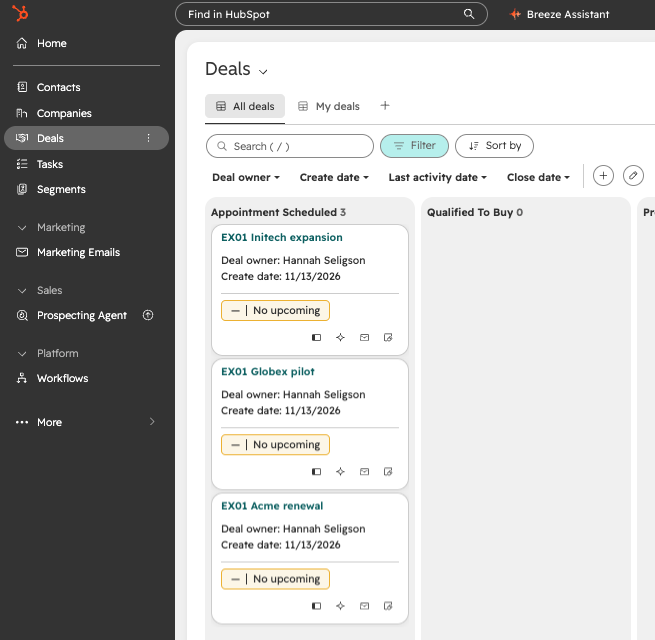

### 2. Do it in chat with MCP (3 minutes)

In Claude, with the HubSpot connector on and connected to your test account, paste the following prompt:

```text
Find my open deals whose names start with EX01 and that have no logged activity in the last 14 days, including deals with no activity at all. List them first. Then, for each one, propose a task titled "Follow up (MCP): <deal name>", with task type To-do, assigned to the deal owner, due tomorrow at 9:00 AM in my time zone, and associated with the deal. Wait for my OK before you create anything.
```

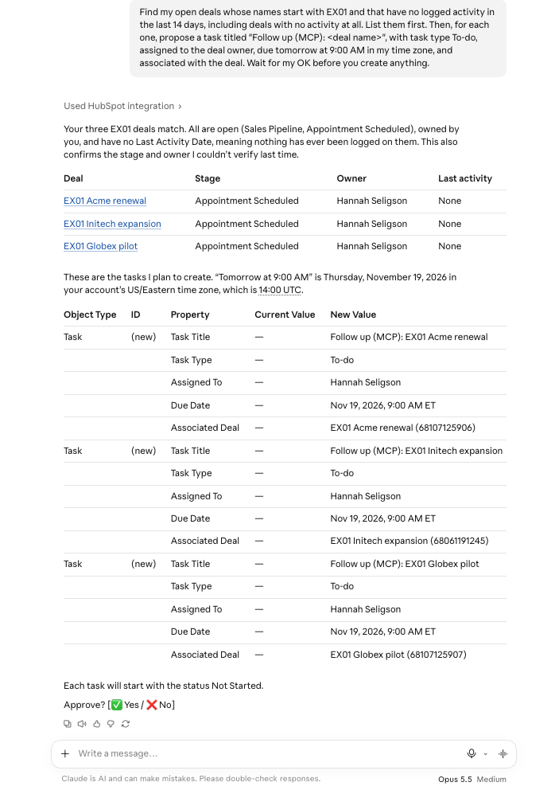

Check the list, then approve the tasks and ask the agent to create them. **You should see:** three tasks marked (MCP), one on each deal within both your Claude instance and your HubSpot account. Claude may say the deals won't show as inactive anymore. They will: tasks set a deal's Next Activity Date, not its Last Activity Date, so the next steps find the same three deals.

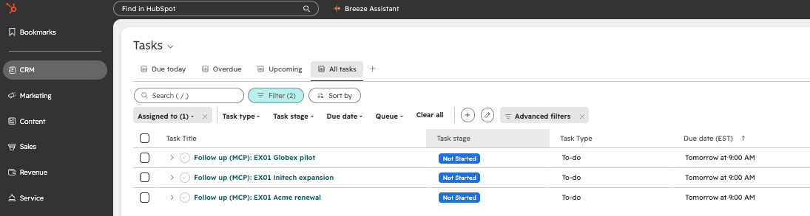

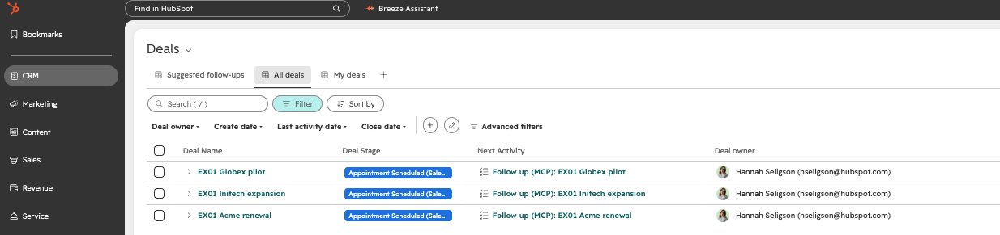

**Use MCP when** you want an answer or an action right now, in conversation, with a person reviewing each change. No code, and new connector capabilities show up without any work on your side.

---

**Prompts only? Skip to step 5.**

---

### 3. Run and change a script with Agent CLI (3 minutes)

**Full version only.**

Using the agent you installed earlier (we're using Claude Code in this example), run the following prompt to generate a script, first as a dry run, then for real:

```text
Use only HubSpot Agent CLI commands run in the terminal (hubspot …). Don't use the HubSpot MCP connector or curl.

Use my OAuth login by default. If a command fails with a 403 or "User level OAuth token is not allowed for this endpoint", rerun only that command as HUBSPOT_ACCESS_TOKEN=$HUBSPOT_TOKEN hubspot … and tell me you did.

Find my open deals whose names start with EX01 and whose notes_last_updated is more than 14 days ago or empty. Search with CONTAINS_TOKEN "EX01", then keep only names that start with EX01.

For each deal, create a task titled "Follow up (CLI): <deal name>", due tomorrow, with hubspot_owner_id set to the deal's hubspot_owner_id. Associate each task with its deal. Set the task type to To-do, and leave priority and status at their defaults.

Show me a dry run first and wait for my OK. Then create the tasks in one batch and save the commands as cli/ex01-stalled-deals.sh, with a --dry-run flag, so I can rerun it.
```

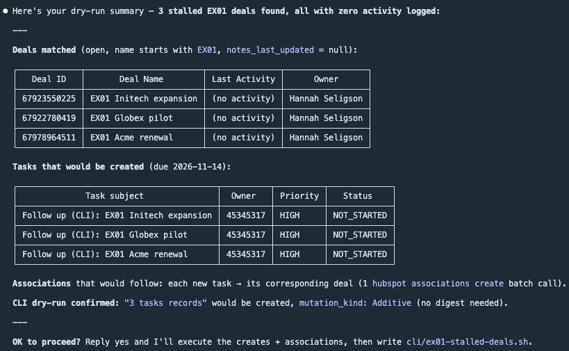

**You should see:** a plan table listing the three deals and their titles, then three tasks marked (CLI). If you see (MCP) calls instead of `hubspot` commands, Claude Code is using the HubSpot connector from step 2: turn off the claude.ai HubSpot server with `/mcp`, then run the prompt again.

Now ask your agent for a change, the way you would adjust it for your own pipeline:

```text
Change cli/ex01-stalled-deals.sh to look back 7 days instead of 14. Show me the diff, but don't run it.
```

**You should see:** a one-line change to the script.

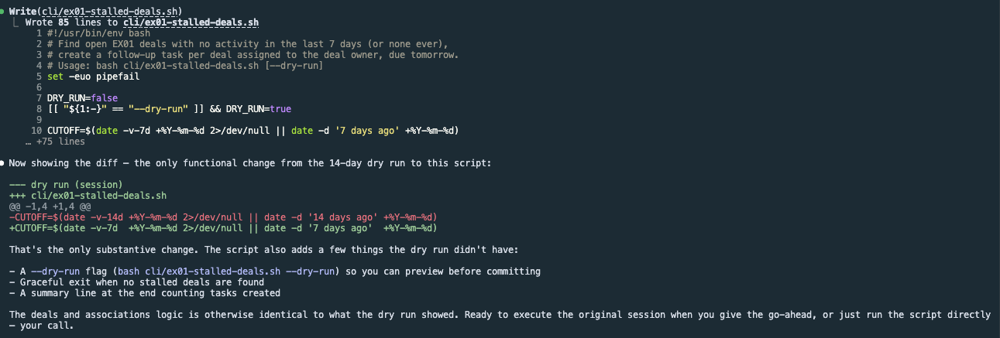

**Use Agent CLI when** the work is repetitive, bulk or scheduled. The logic is written once and saved as a script, so later runs don't spend agent reasoning on every record, and small changes are quick.

### 4. Look under the hood at the API calls (2 minutes)

**Full version only.**

Claude and Agent CLI both did this job by calling HubSpot's CRM APIs. Run the direct version to see those calls from `exercises/ex01-one-job-three-tools/` in the repo:

```sh
node stalled-deals.mjs
```

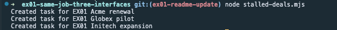

**You should see:** three "Created task" lines in your terminal.

Open `stalled-deals.mjs` and look at the two parts that do the work. The search filter decides exactly which deals count as stalled:

```js
// 1. The search filter decides exactly which deals count as stalled
const search = await hubspot("/crm/objects/2026-09/deals/search", {
  method: "POST",
  body: {
    filterGroups: [
      { filters: [open, ours, { propertyName: "notes_last_updated", operator: "LT", value: String(cutoff) }] },
      { filters: [open, ours, { propertyName: "notes_last_updated", operator: "NOT_HAS_PROPERTY" }] },
    ],
    properties: ["dealname", "hubspot_owner_id"],
    limit: 100,
  },
});
```

And the association links each new task to its deal:

```js
associations: [
  { to: { id: deal.id }, types: [{ associationCategory: "HUBSPOT_DEFINED", associationTypeId: 216 }] },
],
```

Finally, open any EX01 deal in HubSpot. **You should see:** three follow-up tasks, marked (MCP), (CLI) and (API). The result was the same each time; what changed was how much you wrote and how much each run depended on you. New tasks set a deal's Next Activity Date, not its Last Activity Date, so every run finds the same three deals. That's why each deal ends up with one task from each method.

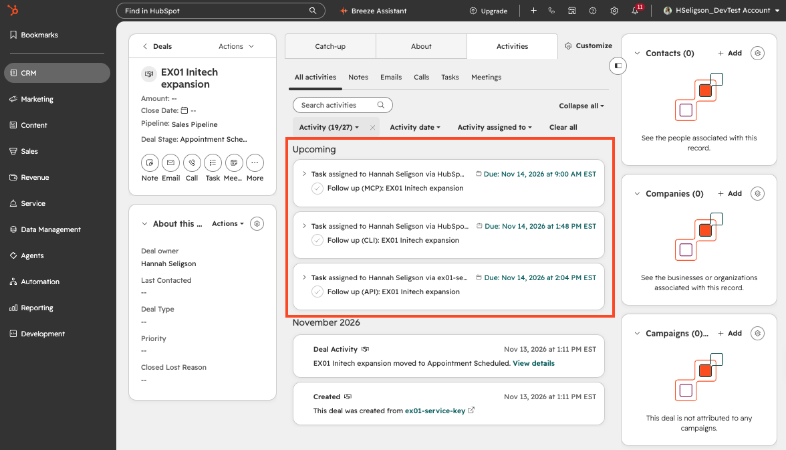

**Reach for the APIs directly** when a job needs to run as a fixed, controlled integration, with every filter and field defined in code. For most jobs, your agent makes these calls for you through the connector or Agent CLI.

### 5. Put it on a schedule in Cowork (2 minutes)

> **Note:** Cowork scheduled tasks are available only in the Claude desktop app, not in Claude on the web or in a browser. If you've been using claude.ai in a browser, switch to the desktop app for this step.

In Claude Cowork, click **Scheduled** in the left sidebar, click **New task**, then choose **Set up manually**.

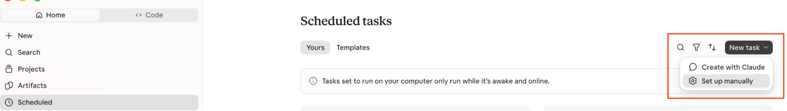

Fill in the form:

- **Task name:** EX01 stalled deal follow-ups
- **Prompt:** Find my open deals whose names start with EX01 and that have no logged activity in the last 14 days, including deals with no activity at all. For each one, create a task titled "Follow up (Scheduled): \<deal name\>", with task type To-do, assigned to the deal owner and due today. Skip any deal that already has an open task whose title starts with "Follow up (Scheduled)".
- **Approval mode:** Automatically approve
- **Frequency:** On weekdays (or whichever cadence you choose)

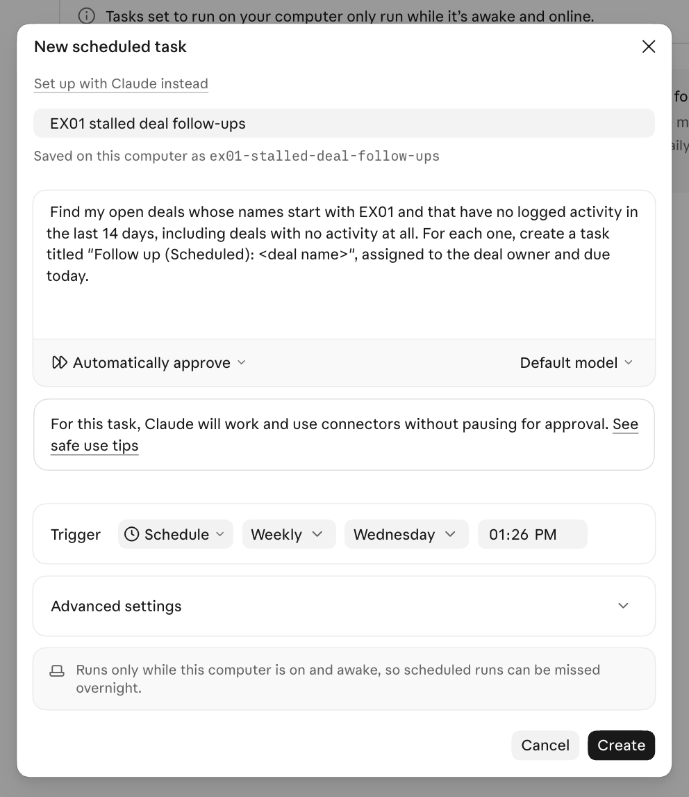

Click **Save**. To see it work without waiting for tomorrow, run the task on demand from the Scheduled tasks page.

**You should see:** a completed run on the Scheduled tasks page, and three new tasks marked (Scheduled), one on each EX01 deal.

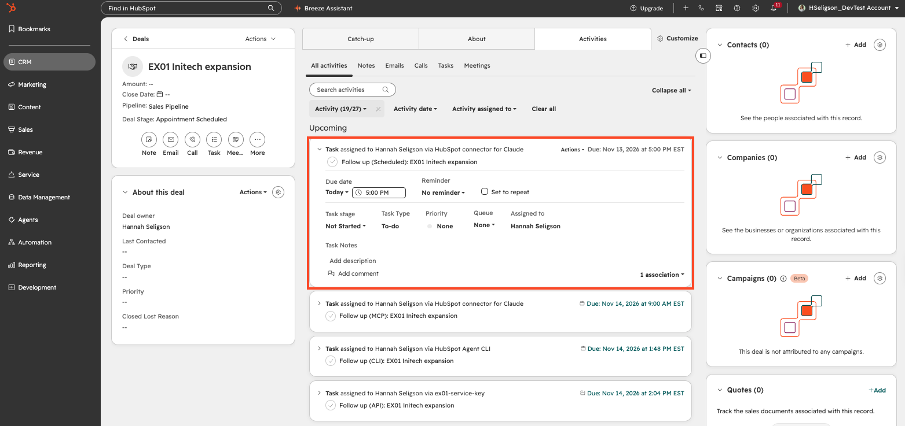

**Use a scheduled task** when the same check should happen without you asking. It uses the same HubSpot connector as step 2 and runs remotely, so it fires even when your computer is asleep.

## What happened under the hood

All three ways in read and wrote the same deals and tasks in the same CRM. The scheduled task in step 5 uses the connector, so it follows the MCP column. What differed was the access model:

| | MCP (connector) | Agent CLI | APIs |
| --- | --- | --- | --- |
| Who decides the logic | The agent, each time you ask | The agent once, then the saved script | You, in code |
| Whose permissions apply | Yours, as the connected user | Yours, via `hubspot auth login`. The service key is used only for commands that need account-level access | The scopes granted to the private app |
| Who reviews changes | You approve each write in chat | You review the script before it runs | Your code and tests |
| Where to check | Your agent's connections UI for the HubSpot connector | Run `hubspot history` | The service key's View logs page |

The public APIs are the foundation layer that MCP and Agent CLI are built on. Step 4 shows that layer directly: one call to the CRM search endpoint to find the deals, and one call per deal to the tasks endpoint to create an associated task.

## Clean up

- **Both paths:** In Cowork, open **Scheduled** and delete the **EX01 stalled deal follow-ups** task, so it stops creating new tasks.

  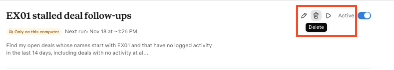

- **Full version:** In the starter repo, run `node cleanup.mjs`. It deletes all EX01 tasks and deals. **You should see:** a "Deleted" line for each record.

  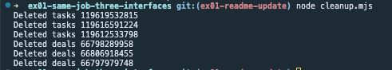

- **Prompts only:** In HubSpot, search your deals and tasks for EX01, select them, and delete them.
- **Full version:** Delete the `builder-exercises` folder if you don't plan to reuse the scripts.
- **Full version:** If you created the service key only for this exercise, delete it or rotate it.

## Keep going

- **MCP:** drop the EX01 filter and save the step 2 prompt as [Claude Project](https://academy.claude.com/courses/claude-101/introduction-to-projects) instructions to make it a weekly pipeline review.
- **Agent CLI:** remove the EX01 filter, change the 14-day window to match your sales cycle, and run the script on a schedule using the [Agent CLI](https://developers.hubspot.com/docs/developer-tooling/local-development/agent-cli/guide) so the tasks are waiting each morning.
- **APIs:** if this job has to run as a fixed integration, start from the search filter and association in step 4 using the [CRM Search API documentation](https://developers.hubspot.com/docs/api-reference/latest/crm/search-the-crm).

Not sure which to pick? Start in chat with your agent. Once it's worth running every day, schedule it in [Claude Cowork](https://academy.claude.com/courses/introduction-to-claude-cowork) like step 5, or move it to Agent CLI for bulk work.

> **Before you run this on a real pipeline:** new tasks don't update a deal's Last Activity Date, so every run finds the same deals again. Add a filter that skips deals that already have a Next Activity Date (`notes_next_activity_date`), so reruns don't stack up duplicate follow-ups.

## Troubleshooting

| If you see | Try this |
| --- | --- |
| Claude finds no deals | The tag in the prompt must match the seeded deals (`EX01`). |
| `HUBSPOT_TOKEN is not set` | The key was exported under a different name. Export it as `HUBSPOT_TOKEN` in the same terminal. |
| The CLI acts with broader permissions than expected | `HUBSPOT_ACCESS_TOKEN` is still set in your terminal. Run `unset HUBSPOT_ACCESS_TOKEN`, then try again. |
| A script fails with 403 | The service key is missing a scope. Compare its scopes with the list in Before you start. |
| Claude returns only some deals | The connector returns a limited number of records per request. Keep the EX01 filter, or use Agent CLI or the APIs for bulk work. |
| You see (MCP) calls instead of `hubspot` commands in step 3 | Claude Code is using the HubSpot connector. Turn off the claude.ai HubSpot server with `/mcp`, then run the prompt again. |
| The agent takes too long to process your prompts | Try switching to a model that isn't labeled "High" or "Max". |
| Claude says it installed the CLI but the login was never finished, or asks you to paste a login code | You're in claude.ai on the web, so Claude installed the CLI in a temporary sandbox. Run the install prompt in Claude Code or Codex on your computer instead. |
| The installer exits with status 2, but `hubspot --version` works | The install succeeded. This is a known installer issue when `$SHELL` isn't set. Keep going. |
| An Agent CLI command fails with a 403 or "User level OAuth token is not allowed for this endpoint" | That command needs account-level access. Rerun just that command as `HUBSPOT_ACCESS_TOKEN=$HUBSPOT_TOKEN hubspot …`, using the service key from setup. |
| `npx skills add` fails because your company uses a private npm registry | Run `npm_config_registry=https://registry.npmjs.org/ npx skills add hubspot/agent-cli-skills`. |
