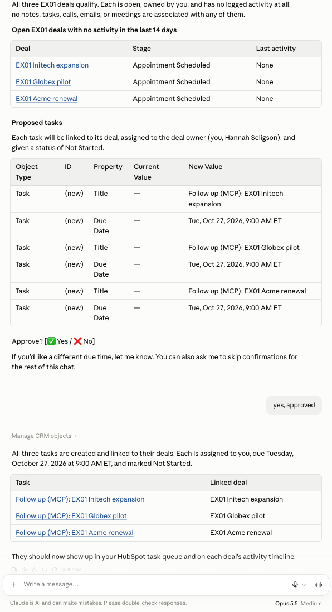

# Same job, three interfaces: follow up on stalled deals

**Time:** about 10 minutes, after setup. **You'll use:** the HubSpot connector in Claude (MCP), Agent CLI (beta), and the CRM APIs. **You'll end up with:** a saved prompt, a reusable CLI script, and a small API script, plus a clear sense of which to reach for next time.

You'll do one real job three ways: find open deals with no activity in the last 14 days, and create a follow-up task on each for the deal owner. Same job, same account, same result. What changes is how much you write, how much you control, and how often it can run without you.

## Before you start (setup, not timed)

- A free HubSpot developer test account. Don't use a production account: this exercise creates and deletes records.
- Claude with the HubSpot connector installed and connected to that test account.
- Claude Code (or Codex) with Agent CLI installed and authenticated to the same account. Install it, then open a new terminal:

  ```
  curl -fsSL https://api.hubapi.com/hub/cli/backend/hub-cli/latest/install.sh | sh
  ```

  Then run these in the new terminal:

  ```
  unset HUBSPOT_ACCESS_TOKEN
  hubspot auth login
  hubspot whoami
  npx skills add hubspot/agent-cli-skills
  ```

  `hubspot whoami` should show your test account. Optionally, run `export HUBSPOT_NO_AUTO_UPGRADE=1` to keep the CLI's behavior stable during the beta.
- Node.js 18 or later, and a service key for the test account with exactly these scopes: `crm.objects.deals.read`, `crm.objects.deals.write`, `crm.objects.contacts.read`, `crm.objects.contacts.write` and `crm.objects.owners.read`. In HubSpot, create it under Development > Keys > Service keys > Create service key.
- This repo, cloned, with your key set: `export HUBSPOT_TOKEN=your-service-key`

The Node scripts use `HUBSPOT_TOKEN` (the service key) and Agent CLI uses OAuth through `hubspot auth login`. They are kept separate on purpose, because Agent CLI reads `HUBSPOT_ACCESS_TOKEN` and would switch to admin mode if it found one.

Run every command below from this folder. Every record this exercise creates starts with `EX01`, so it's easy to find and remove.

## Steps

### 1. Create the sample deals (1 minute)

```
node seed.mjs
```

**You should see:** three "Created EX01" lines, and three EX01 deals in your pipeline with no activity.

New deals can take a few seconds to become searchable. If you jump straight to step 4, wait about 20 seconds first.

### 2. Do it in chat with MCP (3 minutes)

In Claude, with the HubSpot connector on, paste:

```
Find my open deals whose names start with EX01 and that have no logged activity in the last 14 days, including deals with no activity at all. List them first. Then, for each one, create a task titled "Follow up (MCP): <deal name>", assigned to the deal owner and due tomorrow.
```



Check the list, then approve the tasks. **You should see:** three tasks marked (MCP), one on each deal.

**Use MCP when** you want an answer or an action right now, in conversation, with a person reviewing each change. No code, and new connector capabilities show up without any work on your side.

### 3. Run and change a script with Agent CLI (3 minutes)

Preview what the script would do, then run it:

```
sh cli/ex01-stalled-deals.sh --dry-run
sh cli/ex01-stalled-deals.sh
```

**You should see:** a plan table listing the three deals and their task titles, then three tasks marked (CLI). Run the second command again and it skips all three deals, because each already has an open (CLI) task.

Now ask Claude Code for a change, the way you would adjust it for your own pipeline:

```
Change cli/ex01-stalled-deals.sh to look back 7 days instead of 14. Show me the diff, but don't run it.
```

**You should see:** a one-line change to the script.

**Use Agent CLI when** the work is repetitive, bulk or scheduled. The logic is written once and saved as a script, so later runs don't spend agent reasoning on every record, and small changes are quick.

### 4. Run the API version and compare (2 minutes)

```
node stalled-deals.mjs
```

**You should see:** three "Created task" lines in your terminal.

Open `stalled-deals.mjs` and read the two commented parts: the search filter that decides which deals count as stalled, and the association that links each task to its deal.

Finally, open any EX01 deal in HubSpot. **You should see:** three follow-up tasks, marked (MCP), (CLI) and (API). The result was the same each time; what changed was how much you wrote and how much each run depended on you.

**Use the APIs when** you're building a specific, controlled integration: you define every filter and field, it runs inside your own code, and it relies on a versioned public contract.

## What happened under the hood

| | MCP (connector) | Agent CLI | APIs |
| --- | --- | --- | --- |
| Who decides the logic | The agent, each time you ask | The agent once, then the saved script | You, in code |
| Whose permissions apply | Yours, as the connected user | Yours, via hubspot auth login (or the service key's scopes in admin mode) | The scopes granted to the service key |
| Who reviews changes | You approve each write in chat | You review the script before it runs | Your code and tests |
| Where to check | [to confirm] | [to confirm] | The service key's View logs page |

The public APIs are the foundation layer that MCP and Agent CLI are built on. Step 4 shows that layer directly: one call to the CRM search endpoint to find the deals, and one call per deal to the tasks endpoint to create an associated task.

## Clean up

```
node cleanup.mjs
```

**You should see:** a "Deleted" line for each EX01 task and deal, up to 12 lines if you ran all three steps (three MCP tasks, three CLI tasks, three API tasks and three deals). If you see no output, the records may not be searchable yet: wait about 20 seconds and run it again. If you created the service key only for this exercise, delete or rotate the service key. Optionally run `hubspot auth logout`.

## Keep going

- **MCP:** drop the EX01 filter and save the step 2 prompt as Claude Project instructions to make it a weekly pipeline review.
- **Agent CLI:** remove the EX01 filter, change the window to match your sales cycle, and run the script on a schedule. It skips deals that already have an open (CLI) task, so it's safe to re-run.
- **APIs:** add your own business rules, such as pipeline, deal amount or owner team, and run the script inside your own service.

Not sure which to pick? Start in chat. Move to Agent CLI once you're running the same prompt every week, and to the APIs when the logic needs to live inside your own product.

## Troubleshooting

| If you see | Try this |
| --- | --- |
| Claude finds no deals | The tag in the prompt must match the seeded deals (`EX01`). If you just ran `seed.mjs`, wait about 20 seconds and try again. |
| A script prints nothing and exits normally | HubSpot's search index lags a few seconds behind new records, so the search found no deals. Wait about 20 seconds after `seed.mjs` and run the script again. |
| `HUBSPOT_TOKEN is not set` | You exported the key under a different name. Run `export HUBSPOT_TOKEN=your-service-key`. |
| The CLI acts with broader permissions than expected | `HUBSPOT_ACCESS_TOKEN` is set. Run `unset HUBSPOT_ACCESS_TOKEN`. |
| A script fails with 403 | The service key is missing a scope. Edit the key and add it. |
| Claude returns only some deals | The connector returns a limited number of records per request. Keep the EX01 filter, or use Agent CLI or the APIs for bulk work. |
